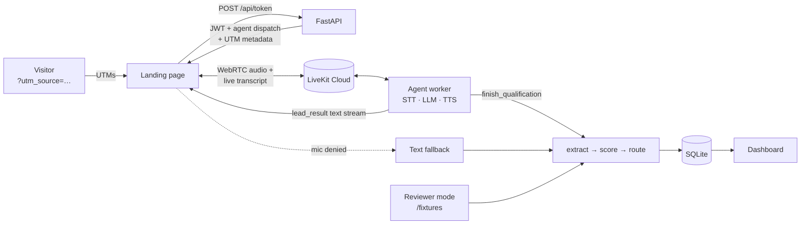

# Voice Lead Qualifier

A voice AI SDR on a landing page. It qualifies visitors out loud, scores them against a transparent rubric, routes them to a meeting, nurture, or self-serve, and attributes every conversation to its campaign.

It's built on **LiveKit Agents** (Python) and **LiveKit Cloud**, with a FastAPI token server, plain HTML/JS frontend, and SQLite.

- **Landing page** (`/`): the Voice AI Readiness Assessment. Talk to the agent, watch a live transcript, and get a result card (tier, score, breakdown, next step).
- **Dashboard** (`/dashboard`): funnel tiles, hot rate by source and campaign, every conversation with its transcript and points per rubric line.
- **Reviewer mode**: three buttons run Hot, Warm, and Low sample transcripts through the real extraction and scoring live. You don't need a mic or any keys.
- **Campaign package** (`/campaign`): brief, three follow-up emails, and the rubric in plain marketer language.



## Quick start

Requires Python 3.10–3.13. (3.14 lacks wheels for some agent dependencies.)

```bash
python3.12 -m venv .venv
.venv/bin/pip install -r requirements.txt
cp .env.example .env          # fill in LiveKit keys for voice (optional)
```

**1. Web server.** This alone runs the landing page, text chat, reviewer mode, and dashboard.

```bash
.venv/bin/uvicorn web.server:app --port 8000
```

(`python3.12 run_web.py --port 8000` does the same without activating the venv.)

Open http://localhost:8000/?utm_source=linkedin&utm_medium=paid_social&utm_campaign=q4-readiness

**2. Voice agent.** Run it in a second terminal. It needs `LIVEKIT_*` in `.env`.

```bash
.venv/bin/python agent/agent.py download-files   # once: VAD model
.venv/bin/python agent/agent.py dev
```

Get keys from a free [LiveKit Cloud](https://cloud.livekit.io) project (Settings → API keys). STT, LLM, and TTS run through **LiveKit Inference** and bill to the same project, so voice needs no other provider keys. Self-hosted `livekit-server --dev` also works: set `AGENT_PROVIDER=openai` and `OPENAI_API_KEY` to use the OpenAI plugins instead.

**3. Tests.** These are the acceptance checks, and they run with zero keys.

```bash
.venv/bin/python -m pytest -q
```

## How a call works

1. The page reads `utm_*` from the URL (none means `direct`) and asks for mic access *before* creating a room. If access is denied, it falls back to text chat.
2. `/api/token` mints a room token with an **explicit agent dispatch** (`lead-qualifier`), and the UTMs go in as dispatch metadata. Attribution travels with the session, so no form is needed.
3. The agent discloses itself, asks the five questions one at a time, and briefly confirms each answer. It answers product questions only from `config/faq.md`. For anything else it says "A human can follow up on that one."
4. After Q5 the LLM calls the `finish_qualification` tool. That tool runs the post-call pipeline: LLM extraction to JSON, deterministic scoring, routing, and saving. It pushes the result card to the browser over a LiveKit text stream (`lead_result`), then the agent speaks the routing line and closes the session.
5. The dashboard polls every 5 seconds, so the new row shows up within seconds.

## Scoring

The rubric lives in [`config/scoring.yaml`](config/scoring.yaml). The file is re-read on every score, so a marketer can change a weight and the **next** conversation uses it, with no code change and no restart. The LLM only extracts answers. The points come from plain rules ([`qualifier/scoring.py`](qualifier/scoring.py)), so every score breaks down line by line. The reasoning for each line is in [`campaign/scoring-rubric.md`](campaign/scoring-rubric.md).

| Tier | Score | Outcome | UI |
|---|---|---|---|
| Hot | 70+ | `meeting_offered` | Booking link (`config/links.yaml`) |
| Warm | 40–69 | `nurture` | Email capture → `nurture` table |
| Low | <40 | `resource` | Docs + getting-started links |

## Edge cases

| Case | Behavior |
|---|---|
| Mic denied or no audio device | Text chat runs the same questions and the same `finalize()` pipeline, so the record has the same shape (`channel = text`) |
| 10s of silence | The agent prompts once (LiveKit `user_away_timeout`). After a second silence it wraps up and saves (`end_reason = silence`) |
| Visitor asks to stop | `stop_call` tool ends at once and saves the partial record |
| Visitor hangs up mid-call | The session-close hook scores what exists and saves it with `incomplete = true` |
| Extraction fails | Transcript saved, `score = null`, `needs_review = true`, outcome `needs_review` |
| Keys missing | App boots. The page shows "Voice not configured". Text chat and reviewer mode work |
| No `OPENAI_API_KEY` | Extraction uses deterministic keyword rules. The method is saved on each record and shown on the card |

## Data model

There's one row per conversation in `data/leads.db`, created at runtime:
`id, created_at, duration_seconds, channel, room_name, transcript (JSON), extracted (JSON), extraction_method, score, tier, outcome, score_breakdown (JSON), utm_source, utm_medium, utm_campaign, incomplete, needs_review, end_reason`. Captured emails go in a `nurture` table.

## Layout

```
agent/agent.py        LiveKit Agents worker (voice SDR, tools, silence + stop handling)
web/server.py         FastAPI: pages, token endpoint, text chat, samples, dashboard API
web/static/           landing page, dashboard, vendored livekit-client
qualifier/            shared core: extraction, scoring, pipeline, storage, FAQ, text chat
config/               scoring.yaml · faq.md · links.yaml   ← marketer-editable
fixtures/             Hot / Warm / Low sample transcripts for reviewer mode
campaign/             brief.md · scoring-rubric.md · emails/
tests/                acceptance checks (no keys needed)
data/                 SQLite, created at runtime
```

## Scope

**MVP:** no CRM sync, no real calendar (placeholder link), no email sending (templates and capture only), English only, one persona.
**Phase 2:** HubSpot sync, real booking, A/B script variants, multilingual.
